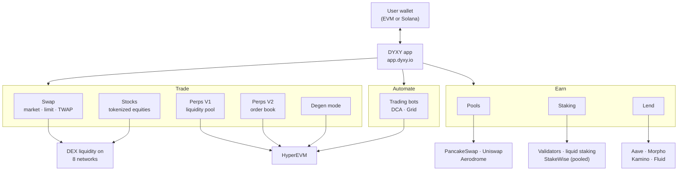
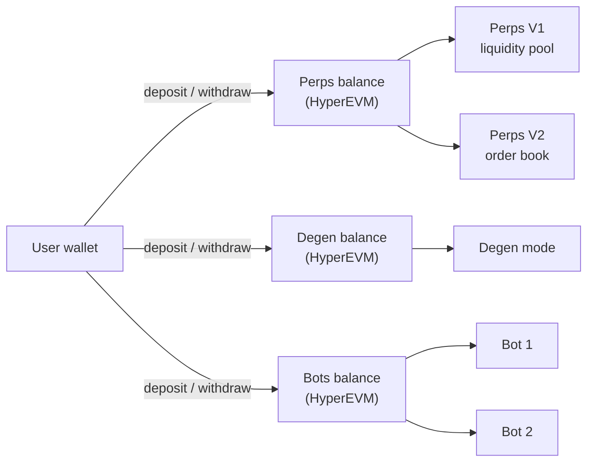
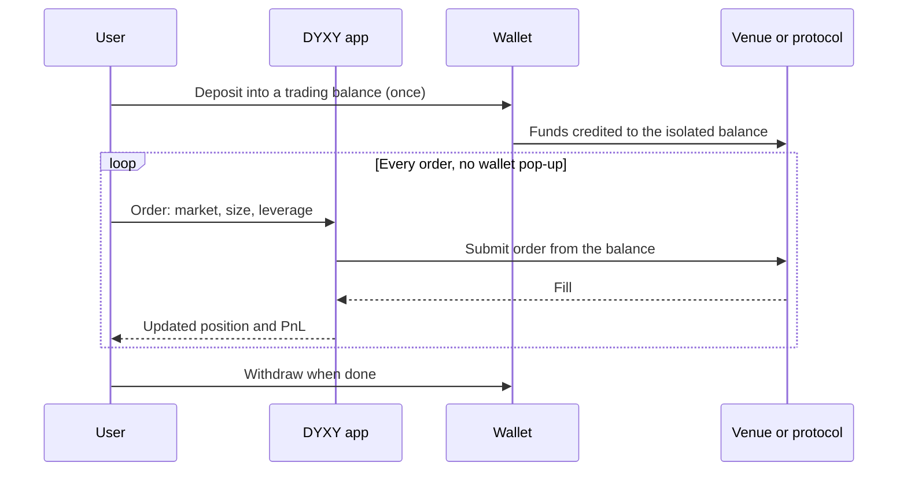

  <picture>
    <source media="(prefers-color-scheme: dark)" srcset="https://docs.dyxy.io/logo/dark.svg">
    
  </picture>

# DYXY architecture

A high-level overview of how DYXY is put together: which venues and protocols each product runs on, how funds move, and where each balance lives.

> This repository describes how DYXY works. It does not contain DYXY source code. For user guides, see [docs.dyxy.io](https://docs.dyxy.io).

## Design principles

- **Aggregate, don't rebuild.** DYXY connects to the deepest existing liquidity and the most established protocols instead of fragmenting liquidity with its own copies.
- **Deposit once, trade instantly.** Perps, Degen mode and bots trade from isolated balances on the HyperEVM engine. Users confirm only deposits and withdrawals in their wallet; orders and bot trades execute without a wallet pop-up each time.
- **Isolate risk by product.** Products that use margin trade from separate balances, so a position in one product cannot draw on funds in another.
- **Wallet-native where it fits.** Swaps, stocks, pools, staking and lending run straight from the user's wallet into the integrated protocols.
- **One interface, many networks.** 8 networks and every product are reachable from one app and one portfolio view.

## System overview

## Where each product runs

| Product | Venue or protocol | Funds held in |
| --- | --- | --- |
| Swap | DEX liquidity on the selected network | User wallet. Tokens leave and return in the same transaction |
| Stocks | Liquidity for tokenized stocks on the issuer's network | User wallet |
| Perps V1 | HyperEVM, liquidity pool | Perps balance |
| Perps V2 | HyperEVM, order book | Perps balance |
| Degen mode | HyperEVM, liquidity pool | Degen balance |
| Trading bots | HyperEVM | Bots balance, in HyperEVM contracts |
| Pools | PancakeSwap, Uniswap, Aerodrome | The protocol's pool contracts |
| Staking | Validators (native), liquid staking protocols (liquid), StakeWise (pooled) | Stake accounts, delegations or liquid staking tokens |
| Lend | Aave, Morpho, Kamino, Fluid | The protocol's lending contracts |

## Balances

Swaps, stocks and earn products run straight from the user's wallet. Products with margin use dedicated balances that the user deposits into first.

| Balance | Used by | Shared between |
| --- | --- | --- |
| Perps balance | Perps V1 and V2 | V1 and V2 draw on the same balance |
| Degen balance | Degen mode | Degen mode only |
| Bots balance | Trading bots | All bots; each bot reserves its own investment |

## Lifecycle of a trade on a balance

## Networks

| Network | Type | Gas token |
| --- | --- | --- |
| Ethereum | EVM, layer 1 | ETH |
| BNB Chain | EVM, layer 1 | BNB |
| Solana | Non-EVM, layer 1 | SOL |
| Arbitrum | EVM, Ethereum layer 2 | ETH |
| Base | EVM, Ethereum layer 2 | ETH |
| HyperEVM | EVM, Hyperliquid's smart contract layer | HYPE |
| Avalanche | EVM, C-Chain | AVAX |
| Robinhood Chain | EVM, built on the Arbitrum platform | ETH |

## Revenue model

DYXY earns two kinds of fees:

| Fee | Products | Referral program |
| --- | --- | --- |
| **Trading fee**, a percentage of traded volume | Perps (V1, V2, Degen mode), trading bots | Yes |
| **Service fee**, as on other aggregators | Swaps, stocks, pools, pooled staking, lending | No |

There are no deposit, withdrawal or subscription fees. Part of trading fees is shared with referrers through the [referral program](https://github.com/dyxy-io/referral-program).

## Product repositories

| Repository | Topic |
| --- | --- |
| [swap](https://github.com/dyxy-io/swap) | Aggregation, routing, market, limit and TWAP orders |
| [perps](https://github.com/dyxy-io/perps) | V1, V2, Degen mode, margin, liquidations, funding |
| [stocks](https://github.com/dyxy-io/stocks) | Tokenized stocks and issuers |
| [trading-bots](https://github.com/dyxy-io/trading-bots) | DCA and Grid strategies |
| [pools](https://github.com/dyxy-io/pools) | Concentrated liquidity and position management |
| [staking](https://github.com/dyxy-io/staking) | Native, liquid and pooled staking |
| [lend](https://github.com/dyxy-io/lend) | Supplying, borrowing and health factor |
| [referral-program](https://github.com/dyxy-io/referral-program) | Trader discount and referrer tiers |
| [portfolio](https://github.com/dyxy-io/portfolio) | Cross-chain portfolio |
| [brand-kit](https://github.com/dyxy-io/brand-kit) | Logos and colors |

## License

Text and diagrams in this repository are licensed under [CC BY 4.0](LICENSE). The DYXY name and logo are not covered by this license. See [brand-kit](https://github.com/dyxy-io/brand-kit).
